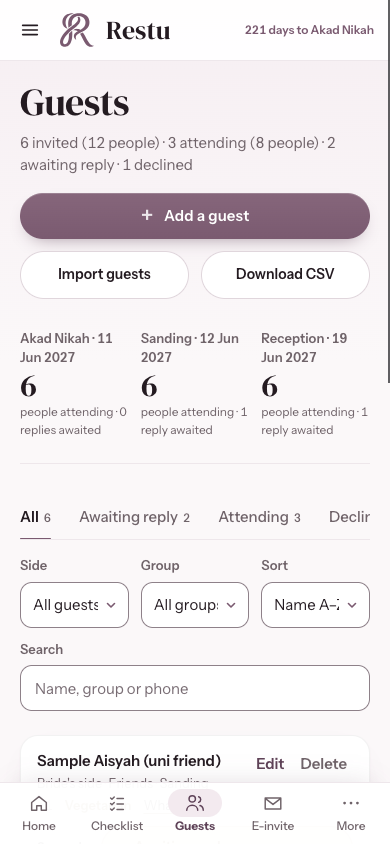
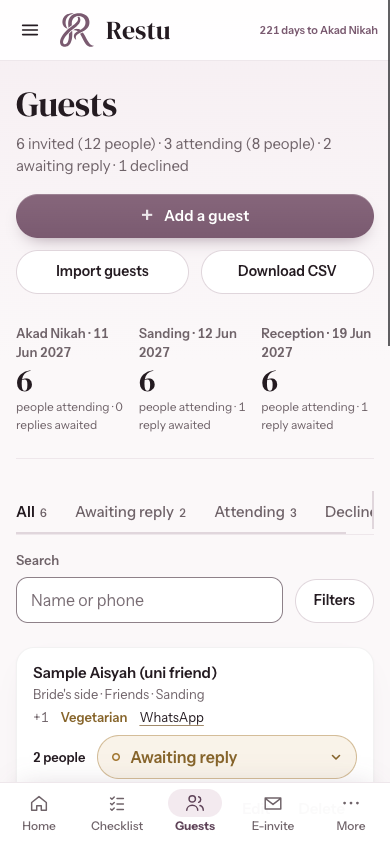
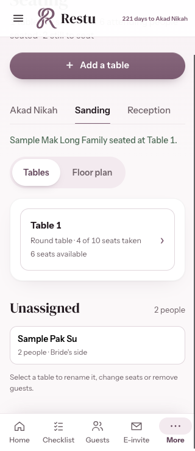
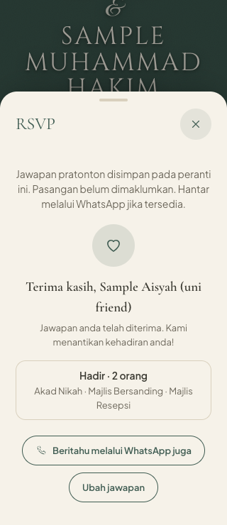

# Restu mobile review

Reviewed on 2 November 2026 using the current local app and an isolated browser with made-up sample data. The review covered setup, Home, marriage procedure, Budget, Checklist, all Calendar views, Hari Majlis, Guests, Seating, the E-invite editor and guest preview, Gifts, Settings, and the shared vendor-category layout.

## Changes implemented

| Area | Finding and correction |
| --- | --- |
| Bottom navigation | A later style override reduced page padding below the fixed bar's height. Restored space for the bar and device safe areas so final controls remain reachable. |
| Menu | The drawer stayed open when a bottom tab or browser history changed the page. Navigation now dismisses it; Escape closes it, and background content cannot take focus or scroll while it is open. More stays highlighted for pages reached through that menu. |
| Forms | Many inputs used 15px text and small controls. Phone inputs now use at least 16px, common actions have at least 44px height, and missing required fields receive focus and scroll into view. |
| Guests | Three narrow filter columns cut off selected values. Search is always visible, while Filters opens readable side/group/sort controls. Names and row actions have their own space. |
| Checklist | Filter pills could expand a 320px viewport. They now wrap within the screen, and task actions have larger touch areas. |
| Calendar | The year view needed narrower grid tracks on small phones. Month, week, day and year views now fit at 320px. |
| Seating | The 720px floor plan made basic assignments awkward on a phone. Phones now start with a table list showing occupancy; the floor plan remains available. Selecting or adding a table brings its controls into view. Switching events clears stale feedback. |
| E-invite editor | The sticky readiness card consumed space above each section. Only the section tabs now stick, selected sections are brought into view, and the horizontal tab row has a visible scrolling affordance. Programme fields stack on narrow phones. |
| Invitation dialogs | Sheets and setup now keep keyboard focus inside, lock background interaction, and restore the opener when closed. Invitation sheets can use the available screen height and scroll internally. |
| Copying an invite | Clipboard permission failure previously directed users to text that was not available to copy. A selectable message now appears directly in the editor. |
| RSVP and gifts | Existing copy implied that putting the frontend online would connect replies and reservations across devices. Editor guidance and guest-facing preview notices now explain their actual local behavior in BM and English. |
| Saving | Storage errors were swallowed. A visible warning now appears when changes cannot be saved, with Retry saving to persist current data after storage is available again. |
| Loading | Invitation editing and preview code are downloaded when opened, rather than all being part of the initial app bundle. The final build has no bundle-size warning. |

## Verification

- Layout sweep: 15 routes at 320, 390, 430, 768 and 1280 CSS pixels. No page-level horizontal overflow in the corrected main layouts. Intentional horizontal scrolling stays within tabs, vendor comparison and floor-plan containers.
- Phone journeys: guest/task/vendor creation, required-event validation, gift entry, wish-list entry, guest deletion and Undo, event filtering, seating assignment, preview RSVP matching, dialog keyboard handling, sample removal, and empty guest-list entry.
- 25 recorded functional assertions passed, with no application runtime errors in that run.
- Simulated browser-storage failure: the warning appeared; Retry saved current values; the saved budget survived reload.
- Source lint and production build passed. Initial app JavaScript is about 494.5 kB before compression, with invitation tools split into separate files.
- The additional clipboard, landscape-sheet and desktop checks are recorded in [verification.json](mobile-review/verification.json).

These are Chrome browser-emulation checks on a Mac. Physical iPhone Safari, Android keyboards, VoiceOver, and actual printer output have not been tested.

## Remaining product improvements

1. **Shared wedding data is the next major requirement.** Local browser storage does not deliver invitations, RSVP replies, wishes or gift reservations between devices. Add a shared backend with accounts and access restricted to each wedding before offering those as live guest services.
2. **Phone matching needs a stronger invitation identity before shared RSVPs go live.** A typed phone number is not proof of identity. Use an unguessable invitation token, appropriate verification where needed, and duplicate/conflict handling so a stranger cannot overwrite a guest's response.
3. **Media recovery is incomplete.** Photos and QR images live in IndexedDB and are excluded from the current JSON backup. Support a backup containing media, or a hosted media store, and provide clear recovery behavior.
4. **Seating currently keeps a family/party together.** A later version should let a couple split a larger party across tables or manage individual members.
5. **Vendor discovery remains manual.** Link parsing and saved contact details do not provide live Google/Instagram results, verified availability or fresh quotes. Treat these as separate integrations with clear source attribution and vendor confirmation.

## Screenshots

### Guests before

### Guests after

### Mobile table list

### Preview RSVP confirmation

